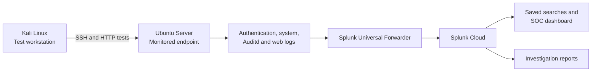

# Splunk SOC Lab — Security Monitoring & Investigation

I built this lab to develop hands-on experience in **security monitoring, detection engineering, and incident investigation** using Splunk Cloud.

The environment includes Kali Linux and Ubuntu Server virtual machines. I generated controlled activity from Kali, collected real authentication, process, file, and web logs from Ubuntu, and analyzed the events in Splunk. From that data, I built reusable searches, a three-tab SOC dashboard, and detailed investigation reports.

The Linux investigations use actual logs from my lab. SOC-001 uses a separate, clearly identified synthetic Windows/VPN dataset. All exercises were authorized and conducted in a controlled environment.

## Featured investigation — SOC-003

### Tracing an SSH login to endpoint activity

**Investigation question:** Can a successful remote login be reliably connected to the commands and file changes that followed?

I initiated an SSH login from Kali to Ubuntu and investigated the resulting activity in Splunk.

1. **Identify the login.** Reviewed authentication events to establish the source, account, and time of the connection.
2. **Correlate activity.** Matched the login with the correct Linux session and its recorded process and file activity, excluding unrelated events.
3. **Validate the evidence.** Examined raw audit records to confirm a test-file creation and distinguish one operation from multiple related log entries.
4. **Document the findings.** Reconstructed the timeline and closed the investigation as authorized lab activity, supported by the evidence.

*SOC-003 investigation workspace with annotations highlighting the session correlation. [Original screenshot](investigations/SOC-003/screenshots/04-session54-correlation.png).*

**[Read the full SOC-003 case report and view all nine annotated evidence screenshots →](investigations/SOC-003/case-report.md)**

## Explore the project

| Project | What it demonstrates |
|---|---|
| **[SOC-003 — Featured investigation](investigations/SOC-003/case-report.md)** | A complete SSH investigation, with timeline, findings, conclusions, and nine annotated evidence screenshots |
| **[Splunk SOC dashboard](dashboards/README.md)** | Three monitoring and investigation views, with five annotated screenshots and the dashboard export |
| **[SOC-002 — Linux endpoint investigation](investigations/SOC-002/README.md)** | A separate live-log investigation tracing an SSH session to process execution and a file change |
| **[SOC-001 — Windows/VPN investigation](investigations/SOC-001/README.md)** | Detection and analysis across 205 synthetic VPN, endpoint, DNS, and identity events |

For a visual overview, see the [evidence gallery](evidence/README.md).

## Skills demonstrated

- **Security monitoring:** Configured Linux log collection and forwarding into Splunk Cloud.
- **Detection engineering:** Developed SPL searches to examine authentication, administrative actions, processes, file changes, and HTTP requests.
- **Incident investigation:** Built evidence-based timelines and traced activity across multiple log sources.
- **Event correlation:** Distinguished events belonging to a specific SSH session from unrelated system activity.
- **Dashboard development:** Built a three-tab Splunk Dashboard Studio workspace for monitoring and investigation.
- **Technical reporting:** Documented findings, supporting evidence, limitations, and justified case dispositions.

## Lab architecture

Kali Linux generates authorized test activity against the monitored Ubuntu Server. Ubuntu's authentication, Auditd, system, and web logs are collected by the Splunk Universal Forwarder and sent to Splunk Cloud. Saved searches and dashboards provide the investigation views used in the case reports.

The virtual machines run in VMware Fusion on an Apple Silicon Mac. The earlier synthetic dataset is stored separately from live lab logs. See the [architecture and setup documentation](architecture/lab-setup.md) for implementation details.

## SOC dashboard

I built a three-tab Dashboard Studio workspace to review incoming security telemetry, examine endpoint activity, and investigate events in context.

| View | Purpose |
|---|---|
| **SOC Overview** | Monitor log sources, event volume, and authentication activity |
| **Endpoint Activity** | Review administrative commands, process execution, file changes, and web requests |
| **Investigation Workspace** | Examine session-specific evidence alongside a wider activity timeline |

*Actual Splunk Cloud dashboard, with annotations highlighting key activity. Metrics represent the selected time window. [Original screenshot](dashboards/screenshots/01-soc-operations-overview.png).*

**[Explore the dashboard and all five annotated screenshots →](dashboards/README.md)**

## Other investigations

### SOC-002 — Linux endpoint investigation

I investigated a separate Kali-to-Ubuntu SSH session, connecting the successful login to recorded process execution and test-file creation. The case demonstrates session attribution and validation of Linux audit evidence using live lab logs.

**[Read SOC-002](investigations/SOC-002/README.md)**

### SOC-001 — Multi-source security investigation

Using **205 synthetic events** covering VPN authentication, Windows processes, DNS, and identity changes, I reconstructed a sequence of potentially suspicious activity. The evidence supported further investigation but did not establish a confirmed compromise.

**[Read SOC-001](investigations/SOC-001/README.md)**

## Detection engineering and validation

The lab includes SPL searches for SSH authentication, sudo activity, process execution, monitored file changes, HTTP requests, and session correlation.

I saved **eight Linux reports** in Splunk Cloud and documented **five historical reports** for the synthetic dataset. These are reusable searches, **not deployed real-time alerts**. Several searches were tested against live activity; the [validation matrix](docs/linux-report-validation-matrix.md) identifies remaining checks and limitations.

The [Linux detection catalog](detections/linux/README.md), [historical detections](detections/README.md), [SPL/report runbook](docs/report-save-runbook.md), [test plan](docs/detection-test-plan.md), and [triage playbook](docs/detection-triage-playbook.md) provide the technical detail.

## Tools and technologies

| Tool | Role |
|---|---|
| Splunk Cloud / SPL | Central log search, reporting, dashboard and investigation |
| Splunk Universal Forwarder 10.4.3 | Forward Linux logs to Splunk Cloud |
| Ubuntu Server 24.04 | Monitored Linux endpoint |
| Kali Linux | Authorized activity-generation workstation |
| Linux Auditd | Record selected process executions and monitored file operations |
| VMware Fusion / Apple Silicon | Run the isolated lab virtual machines |

The live data is stored in Splunk's `soc-live` index; the synthetic historical data is kept in `soc_lab`.

## Technical documentation

- [SOC-003 case report and screenshot gallery](investigations/SOC-003/case-report.md)
- [Dashboard screenshots and exported JSON](dashboards/README.md)
- [Evidence index](evidence/README.md)
- [Lab architecture and setup](architecture/lab-setup.md)
- [Telemetry and log collection](telemetry/README.md)
- [Detection engineering catalog](detections/README.md)
- [Linux report validation matrix](docs/linux-report-validation-matrix.md)
- [SOC investigation triage playbook](docs/detection-triage-playbook.md)
- [Lessons learned](docs/lessons-learned.md)
- [Demonstration storyboard](docs/recruiter-demo-script.md)
- [Project roadmap](docs/roadmap.md)

## Scope and lessons learned

This is a **personal, controlled security lab**, not a production SOC. The investigations document observed evidence and do not represent real-world compromises. A successful login alone is not proof of unauthorized access, and a suspicious-looking command does not establish malicious intent.

The dashboard and case reports are documented, with authentic screenshots. Additional work remains around full saved-search reconciliation, scheduled alerting, Auditd rule persistence and collection hardening; those operational improvements are tracked separately in the [roadmap](docs/roadmap.md) and [limitations](docs/limitations.md).
