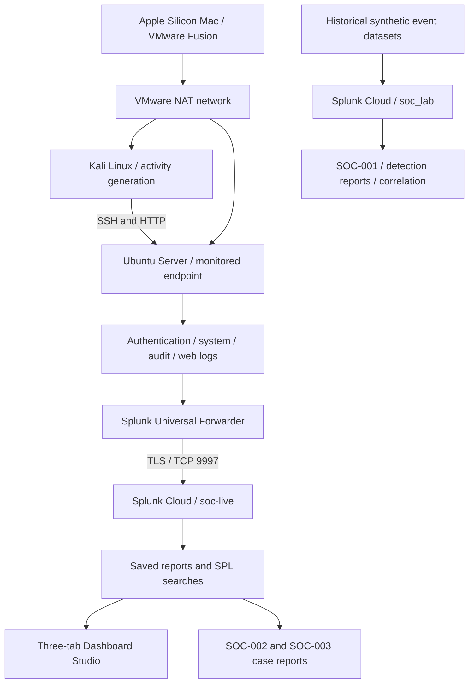
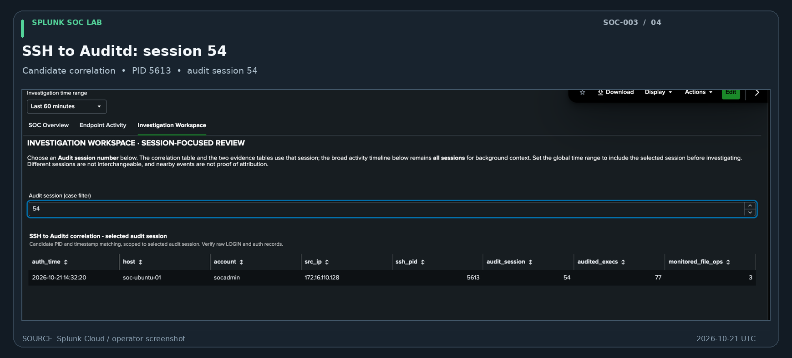

# Splunk SOC Detection Engineering Lab

A hands-on security operations portfolio project combining **live Linux telemetry, Splunk detection searches, a three-tab analyst dashboard, and evidence-based incident investigations**.

Built with Splunk Cloud, Ubuntu Server, Kali Linux, Auditd, and VMware Fusion. The lab follows the workflow from log collection through investigation and analyst disposition.

## Start here

- **[SOC-003 — SSH-to-Auditd investigation](investigations/SOC-003/case-report.md)** — Follow a Kali SSH login to its matching Auditd session, process evidence, and verified file creation, with nine real screenshots.
- **[SOC dashboard](dashboards/README.md)** — Three operational tabs covering telemetry, endpoint activity, and session-scoped investigation, with five screenshots.
- **[SOC-002 — Earlier Linux investigation](investigations/SOC-002/README.md)** — Authentication-to-process/file correlation in the live lab.
- **[SOC-001 — Historical investigation](investigations/SOC-001/README.md)** — Multi-source investigation using a synthetic security dataset.
- **[Evidence index](evidence/README.md)** — Published exhibits and remaining evidence checks.

## What this demonstrates

- Collecting SSH, syslog, Auditd, and HTTP telemetry from a monitored Ubuntu VM into Splunk Cloud.
- Writing SPL to summarize authentication, process execution, file operations, and web requests.
- Linking SSH authentication to Auditd LOGIN using host, process ID, timestamp, and session context.
- Interpreting multiple Auditd records as one underlying audited event where appropriate.
- Building a three-tab Dashboard Studio workspace with a global time picker and session-scoped evidence.
- Writing reproducible investigations with limitations and justified dispositions.

**Current scope:** The dashboard and three case studies are documented; eight live Linux reports are saved. Broader detection validation, scheduled alerting, and infrastructure hardening remain separate work. This is a controlled personal lab, not a production SOC.

## Lab architecture

The diagram below separates the live Linux pipeline from the historical synthetic dataset. [Architecture and setup details](architecture/lab-setup.md) explain the network, sources and operational caveats.

## Technology stack

| Component | Technology | Role |
|---|---|---|
| SIEM | Splunk Cloud | Centralized search, analysis and reporting |
| Collection | Splunk Universal Forwarder 10.4.3 ARM64 | Linux log forwarding |
| Monitored endpoint | Ubuntu Server 24.04 LTS | Authentication, process, file and web telemetry |
| Test workstation | Kali Linux | Controlled SSH and HTTP activity |
| Audit | Linux Auditd | Process execution and file modification events |
| Virtualization | VMware Fusion on Apple Silicon | Two-VM lab environment |
| Analysis | Splunk Search Processing Language | Detection, aggregation and event correlation |

## Security telemetry

The Ubuntu endpoint forwards four complementary log sources into `index="soc-live"`.

| Source | Splunk sourcetype | Security visibility |
|---|---|---|
| `/var/log/auth.log` | `linux_secure` | SSH and administrative authentication |
| `/var/log/syslog` | `syslog` | Operating system and service activity |
| `/var/log/audit/audit.log` | `linux:audit` | Selected process executions and file modifications |
| `/opt/soc-web-logs/access.log` | `soc:web:access` | HTTP requests and response codes |

An initial three-source search returned 6,128 log records, including 5,263 syslog, 644 Auditd and 221 authentication records. HTTP collection was added separately. Auditd can produce multiple records for one operation, so raw record counts are not equivalent to action counts.

*Figure 1 — Actual Splunk Cloud dashboard showing monitored Linux sources and analyst views.*

See [telemetry documentation](telemetry/README.md), [forwarder configuration](telemetry/splunk-forwarder-config.md), and [Auditd rules](telemetry/auditd-rules.md).

## Security investigations

### SOC-001 — Suspicious authentication and privilege-related activity

A structured investigation using 205 synthetic security events across VPN authentication, endpoint processes, DNS queries, and Windows identity auditing.

The timeline includes repeated failed VPN authentication followed by success, account/group discovery, an unusual DNS query, and security group membership activity. The event sequence warranted escalation for additional investigation; the available evidence did not establish compromise.

[Read the SOC-001 case study](investigations/SOC-001/README.md)

### SOC-002 — Linux endpoint activity

A completed, controlled Linux investigation correlating Kali SSH authentication (PID 4937), Auditd login session 27, `whoami`/`id`/`touch` process executions, and a successfully recorded file creation operation. Disposition: authorized lab activity, not confirmed compromise.

[Read the SOC-002 case study](investigations/SOC-002/README.md)

### SOC-003 — Kali-to-Ubuntu SSH and Auditd correlation

A completed controlled investigation traced an authorized Kali SSH login (**source `172.16.110.128`; PID `5613`**) to a matching Auditd LOGIN (**session `54`**), session-scoped process records, and a successfully created monitored file. The analyst examined all **five** companion Auditd records for the file-creation event (two PATH, CWD, SYSCALL and PROCTITLE), distinguished them from three grouped file-operation IDs, and separated a preceding Ubuntu-originated failed-login example (**session `53`**) from the Kali case. Disposition: **authorized lab activity, no confirmed compromise**.

[Read the SOC-003 analyst case report](investigations/SOC-003/case-report.md) · [Reproduction runbook](investigations/SOC-003/README.md)

*Figure 2 — Session-focused correlation in the actual Investigation Workspace. See the [full case evidence gallery](investigations/SOC-003/case-report.md#evidence-gallery--real-screenshots).*

## Detection engineering

The historical dataset supports five saved Splunk reports:

| ID | Detection focus |
|---|---|
| DET-001 | Repeated failed VPN authentication followed by success |
| DET-002 | PowerShell account and group discovery |
| DET-003 | Sensitive security group membership additions |
| DET-004 | Rare DNS queries |
| COR-001 | Authentication failures, success, and subsequent group discovery |

The searches incorporate filtering, aggregation, chronological ordering and tuning of known-benign activity. These are saved reports rather than active alerting rules.

The Linux detection track covers SSH authentication, sudo activity, monitored file changes, selected process execution, web requests and cross-source correlation. The [file-change pilot and its SPL](detections/linux/LINUX-DET-003-file-change.md) are documented, but Linux scheduled alerts have not yet been deployed. See the [detection-to-dashboard implementation plan](docs/detection-to-dashboard-plan.md) for validation, tuning, saved reports and dashboard sequencing.

### Live reporting pack and end-to-end investigation

All **eight live Linux reports** have been saved in Splunk Cloud and connected to the three-tab Dashboard Studio dashboard. The [report runbook](docs/report-save-runbook.md) records the exact saved-report titles and SPL source files. Their results and time-range behavior are being validated: the [dashboard validation log](docs/dashboard-validation-2026-10-21.md) documents tests, open limitations, and attribution questions. The [SOC-003 investigation](investigations/SOC-003/case-report.md) is now documented from real controlled-lab authentication and Auditd evidence, including raw file-creation records; the curated, original-data screenshot gallery has now been published.

## SOC dashboard

The [dashboard section](dashboards/README.md) contains the **actual exported three-tab Dashboard Studio definition**, with source inventory, ingestion trends, SSH sessions, sudo commands, process and file auditing, HTTP logs, candidate correlation and investigation timeline. All eight saved-report sources are bound to the dashboard's global time-range input. Investigation Workspace also supports a selected Auditd session for the correlation and file/process evidence tables, preserving a separate all-session context timeline. Session 33 and session 6 evidence filtering was tested in the lab; independent authentication attribution remains a separate check. See the [validation log](docs/dashboard-validation-2026-10-21.md).

*Figure 3 — Endpoint investigation panels using saved Splunk reports. [Browse five dashboard screenshots](dashboards/README.md#screenshot-gallery).*

## Project documentation

- [Lab architecture and setup](architecture/lab-setup.md)
- [Log collection and telemetry](telemetry/README.md)
- [Detection engineering](detections/README.md)
- [SOC-001 investigation](investigations/SOC-001/README.md)
- [SOC-002 investigation](investigations/SOC-002/README.md)
- [SOC-003 analyst case report and screenshots](investigations/SOC-003/case-report.md)
- [Evidence gallery](evidence/README.md)
- [Engineering considerations](docs/limitations.md)
- [Lessons learned](docs/lessons-learned.md)
- [Development roadmap](docs/roadmap.md)
- [Linux report validation matrix](docs/linux-report-validation-matrix.md)
- [Detection test plan](docs/detection-test-plan.md)
- [SOC analyst triage playbook](docs/detection-triage-playbook.md)
- [Short demonstration storyboard](docs/recruiter-demo-script.md)
- [Demonstration](demo/README.md)

## Engineering considerations

This project is a personal lab, not a production SOC deployment. Historical SOC-001 events are synthetic; Linux endpoint telemetry is generated through controlled testing. Correlation results are evaluated against available session context, and suspicious patterns are not treated as proof of compromise. Secrets, credential packages and sensitive raw logs are excluded from the repository.

