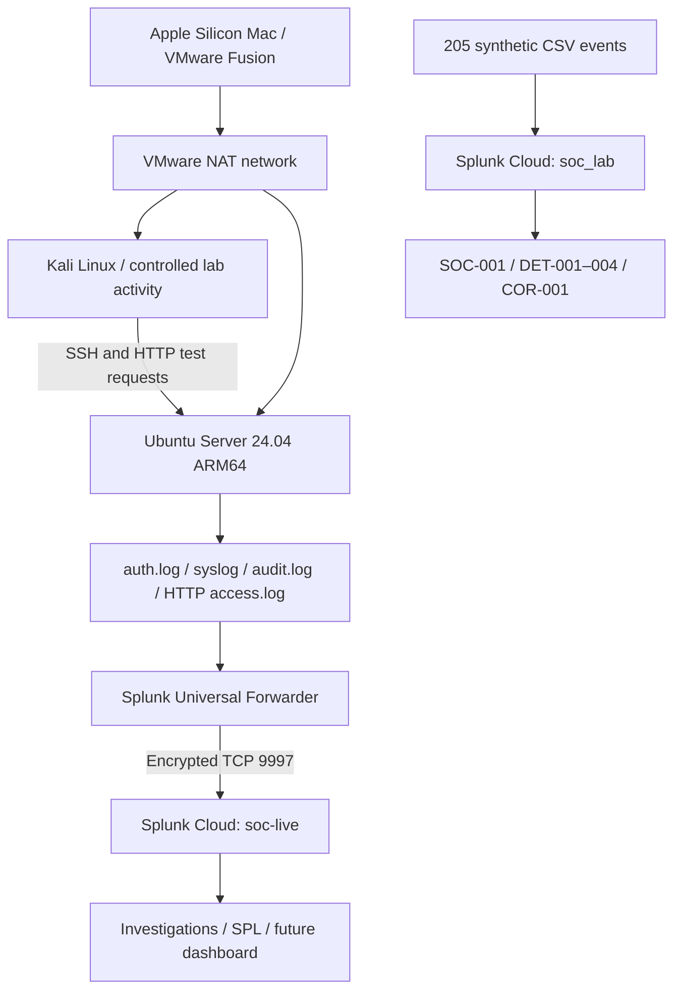

# Splunk SOC Detection Engineering Lab

Hands-on security monitoring, detection engineering, and incident investigation using **Splunk Cloud, Ubuntu Server, Kali Linux, Auditd, and SPL**.

> **Status: In progress (October 2026).** A historical synthetic investigation and five saved Splunk reports are complete. Four categories of real Linux telemetry have been validated. The live Linux investigation, Linux detections, and dashboard are not yet complete. This is a controlled personal lab, not production SOC experience.

## Project at a glance

| Capability | Evidence | Status |
|---|---|---|
| SIEM ingestion | Splunk Universal Forwarder 10.4.3 ARM64 → Splunk Cloud TCP/9997 TLS | Verified |
| Linux telemetry | syslog, auth.log, Auditd, HTTP access log | Verified |
| SOC-001 | 205 synthetic events, evidence-based escalation | Complete |
| Historical detections | DET-001–004 and COR-001 saved as **reports**, not alerts | Complete |
| SOC-002 | Real Linux investigation, session attribution | In progress |
| Linux detections | SSH, sudo, file changes, processes, web, correlation | Planned |
| SOC dashboard | Dashboard Studio | Planned |

## Architecture

**[PLACEHOLDER: finalized architecture image]**

## Live data sources

| Source | Sourcetype | Purpose |
|---|---|---|
| `/var/log/syslog` | `syslog` | System and service logs |
| `/var/log/auth.log` | `linux_secure` | SSH and administrative authentication |
| `/var/log/audit/audit.log` | `linux:audit` | Selected process and file audit records |
| `/opt/soc-web-logs/access.log` | `soc:web:access` | Temporary Python HTTP server requests |

Verified in `index="soc-live"`. An earlier three-source snapshot contained **6,128 records** (5,263 syslog; 644 Auditd; 221 auth). This excludes later HTTP logs and is not a current total. Multiple Auditd records may describe one operation.

**[PLACEHOLDER: ingestion source breakdown screenshot]**

## Investigations

- [SOC-001 — Synthetic authentication and privilege investigation](investigations/SOC-001/README.md): eight failed VPN logins followed by success, discovery, unusual DNS, and identity changes. Escalated for further investigation; no confirmed compromise.
- [SOC-002 — Live Linux endpoint investigation](investigations/SOC-002/README.md): working investigation; cross-source timeline and session attribution remain to be validated.

## Detection engineering

[Detection catalog](detections/README.md): four saved standalone reports and one correlation report. Exact saved SPL definitions have **not yet been exported**. Linux detections are planned, not implemented.

## Documentation

- [Architecture and setup](architecture/lab-setup.md)
- [Telemetry collection](telemetry/README.md)
- [Forwarder configuration](telemetry/splunk-forwarder-config.md)
- [Auditd rules](telemetry/auditd-rules.md)
- [Dashboard plan](dashboards/README.md)
- [Evidence and screenshots checklist](evidence/README.md)
- [Limitations and security](docs/limitations.md)
- [Lessons learned](docs/lessons-learned.md)
- [Project roadmap](docs/roadmap.md)
- [Demo placeholder](demo/README.md)

## Responsible lab scope

Testing is limited to owned lab VMs. NAT does not guarantee isolation. No credentials, Splunk Cloud packages, tokens, sensitive raw logs, or passwords belong in this repository. Synthetic IP `203.0.113.77` and `.example` domains are documentation-only.

**[PLACEHOLDER: recruiter walkthrough video]**
