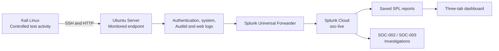
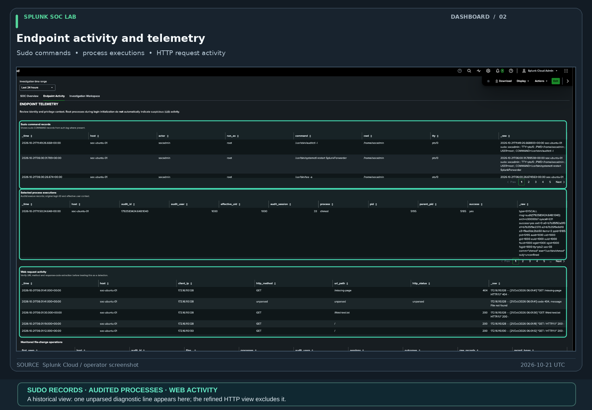

# Splunk SOC Lab — Security Monitoring & Investigation

I built this lab to practice how a security analyst investigates activity on a real system: **collect logs, recognize useful signals, connect events across different sources, and explain what the evidence shows.**

Using two virtual Linux machines and Splunk Cloud, I generated controlled activity, monitored it, built an investigation dashboard, and documented three cases. The goal was to go beyond following a tutorial and practice the decisions an analyst makes when investigating an event.

The Linux investigations use **real logs from my lab**. The earlier Windows/VPN investigation uses a **clearly identified synthetic dataset**. All activity was authorized; these are training cases, not claims of real-world attacks.

## Start here — strongest work

| Project highlight | What you'll see | Why it matters |
|---|---|---|
| **[SOC-003: Complete Linux investigation](investigations/SOC-003/case-report.md)** | A step-by-step investigation tracing a Kali SSH login to a Linux audit session, executed commands and a file creation; **nine real screenshots** | Demonstrates evidence-based investigation, cross-source correlation and clear case reporting |
| **[Splunk SOC dashboard](dashboards/README.md)** | Three working views for monitoring, endpoint activity and investigation; **five real screenshots** | Shows how raw logs become a practical analyst workspace |
| **[SOC-002: Linux endpoint investigation](investigations/SOC-002/README.md)** | An earlier SSH-to-process-and-file investigation using live Linux logs | Shows repeatable investigation methodology |
| **[SOC-001: Multi-source investigation](investigations/SOC-001/README.md)** | Analysis of VPN, Windows, process and DNS activity from 205 synthetic events | Shows detection logic, event sequencing and cautious conclusions |

**Best place to begin:** [Read SOC-003](investigations/SOC-003/case-report.md), then [view the dashboard screenshots](dashboards/README.md#screenshot-gallery). The [evidence index](evidence/README.md) collects additional exhibits.

*The SOC Overview presents indexed-event volume, monitored sources, SSH sessions, and grouped file operations for the selected time range. Counts are time-window snapshots, not an uptime guarantee.* · [Original PNG](dashboards/screenshots/01-soc-operations-overview.png)

## Skills demonstrated

- **Security monitoring (SIEM):** Forwarded Linux authentication, system, audit and web logs into Splunk Cloud and searched them together.
- **Incident investigation:** Reconstructed what happened, in what order, and which evidence supported each conclusion.
- **Detection engineering:** Wrote and refined Splunk searches for authentication patterns, process activity, file changes, web requests and event correlation.
- **Multi-source correlation:** Linked an SSH login to the correct Linux audit session using matching host, process ID and timestamp rather than assuming nearby events were related.
- **Dashboard development:** Built a three-tab Splunk Dashboard Studio workspace with time controls and session-specific investigation views.
- **Technical reporting:** Wrote case timelines, findings, limitations and defensible dispositions, including when the evidence **did not** support a compromise claim.

## How the lab works

I run **Kali Linux** as an authorized test workstation and **Ubuntu Server** as the monitored endpoint, both in VMware Fusion on an Apple Silicon Mac. Ubuntu records authentication, operating-system, process, file and web activity. A **Splunk Universal Forwarder** sends those logs to **Splunk Cloud**, where I search, correlate and investigate them.

The separate `soc_lab` index contains synthetic historical events used for SOC-001 and its detection exercises. [Architecture and setup details](architecture/lab-setup.md) explain the environment and collection path.

## Featured investigation — SOC-003

**Question:** Can I trace a successful remote login to the commands and file activity that followed it, using more than one log source?

I initiated an approved SSH connection from Kali to Ubuntu and then examined the resulting logs in Splunk.

1. **Find the login.** Ubuntu's authentication log showed the Kali source address and SSH process ID **5613**.
2. **Confirm the session.** A matching Linux Auditd LOGIN record used the same host, process ID and timestamp and assigned **audit session 54**.
3. **Review endpoint activity.** The dashboard showed commands such as `whoami`, `id`, `chmod` and `stat` within that session.
4. **Confirm the file operation.** Raw Auditd evidence showed a successful creation of a file in the approved test directory. Five related audit records described **one operation**, not five separate file changes.
5. **Reach a supported conclusion.** The activity matched the planned exercise and was closed as **authorized lab activity**, not an intrusion.

The investigation also separated an unrelated local SSH test from the Kali session rather than combining them into one story.

*The workspace is filtered to session `54` and identifies Kali source `172.16.110.128` and SSH PID `5613`. The 77 audited executions are aggregated Auditd events, not 77 individually verified human-entered commands.* · [Original PNG](investigations/SOC-003/screenshots/04-session54-correlation.png)

**[Read the full SOC-003 case report and see all nine screenshots](investigations/SOC-003/case-report.md)**

## Splunk dashboard

The dashboard turns several kinds of Linux logs into three views designed around an analyst's workflow.

| View | Purpose |
|---|---|
| **SOC Overview** | See which sources are sending data and review authentication and file activity |
| **Endpoint Activity** | Examine sudo commands, audited processes, monitored file changes and HTTP requests |
| **Investigation Workspace** | Select an audit session and review related evidence alongside the broader event timeline |

Eight saved Linux reports support the dashboard. A global time picker controls the search window, and the investigation workspace provides a session filter for case-specific process and file evidence.

*Endpoint Activity combines sudo, audited process execution, and HTTP tables. This earlier capture includes a diagnostic line classified as unparsed; the cleaned HTTP evidence appears in Exhibit 05.* · [Original PNG](dashboards/screenshots/02-endpoint-telemetry.png)

**[Explore the dashboard, screenshots and exported configuration](dashboards/README.md)**

## Other investigations

### SOC-002 — Linux authentication to file creation

This live-log exercise traced a Kali SSH login through Linux audit session **27**, process executions (`whoami`, `id`, `touch`) and a successful test-file creation. It reinforced how to establish session identity and avoid mistaking multiple audit records for multiple actions.

**[Read SOC-002](investigations/SOC-002/README.md)**

### SOC-001 — Multi-source investigation

Using **205 synthetic security events**, I investigated repeated VPN login failures followed by success, account and group discovery, a rare DNS query, and a Windows group-membership change. I wrote detection and correlation searches, evaluated benign explanations, and documented why the evidence warranted further review without proving compromise.

**[Read SOC-001](investigations/SOC-001/README.md)**

## Detection engineering

I created searches to answer practical questions: Which SSH connections succeeded or failed? What processes executed? Which monitored files changed? Which web requests were recorded? Can authentication events be connected to activity in the same audit session?

The project includes **eight saved live Linux reports** and **five historical reports** for the synthetic dataset. These are reusable Splunk searches, **not deployed real-time alerts**. Selected searches and case evidence have been tested; the [validation matrix](docs/linux-report-validation-matrix.md) distinguishes those results from additional checks.

For the technical detail, see the [Linux detection catalog](detections/linux/README.md), [historical detection catalog](detections/README.md), [SPL/report runbook](docs/report-save-runbook.md), [test plan](docs/detection-test-plan.md) and [analyst triage playbook](docs/detection-triage-playbook.md).

## Tools and technologies

| Tool | Role |
|---|---|
| Splunk Cloud / SPL | Central log search, reporting, dashboard and investigation |
| Splunk Universal Forwarder 10.4.3 | Forward Linux logs to Splunk Cloud |
| Ubuntu Server 24.04 | Monitored Linux endpoint |
| Kali Linux | Authorized activity-generation workstation |
| Linux Auditd | Record selected process executions and monitored file operations |
| VMware Fusion / Apple Silicon | Run the isolated lab virtual machines |

The live data is stored in Splunk's `soc-live` index; the synthetic historical data is kept in `soc_lab`.

## Documentation and reproducibility

- [SOC-003 case report and screenshot gallery](investigations/SOC-003/case-report.md)
- [Dashboard screenshots and exported JSON](dashboards/README.md)
- [Evidence index](evidence/README.md)
- [Lab architecture and setup](architecture/lab-setup.md)
- [Telemetry and log collection](telemetry/README.md)
- [Detection engineering catalog](detections/README.md)
- [Linux report validation matrix](docs/linux-report-validation-matrix.md)
- [SOC investigation triage playbook](docs/detection-triage-playbook.md)
- [Lessons learned](docs/lessons-learned.md)
- [Demonstration storyboard](docs/recruiter-demo-script.md)
- [Project roadmap](docs/roadmap.md)

## Scope and lessons learned

This is a **personal, controlled security lab**, not a production SOC. The investigations document observed evidence and do not represent real-world compromises. A successful login alone is not proof of unauthorized access, and a suspicious-looking command does not establish malicious intent.

The dashboard and case reports are documented, with authentic screenshots. Additional work remains around full saved-search reconciliation, scheduled alerting, Auditd rule persistence and collection hardening; those operational improvements are tracked separately in the [roadmap](docs/roadmap.md) and [limitations](docs/limitations.md).
