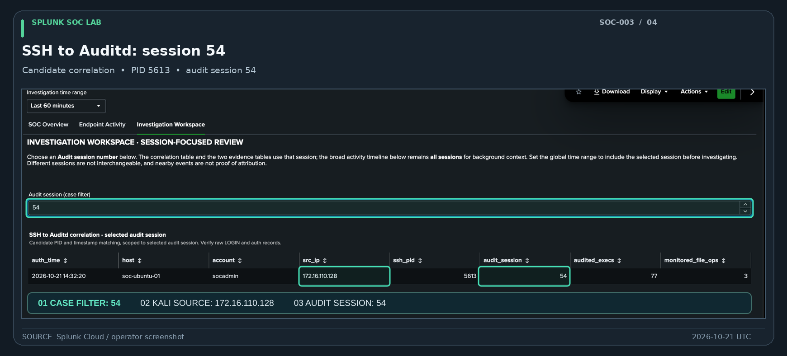
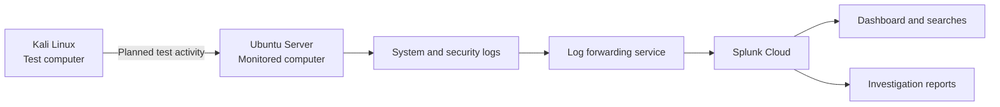
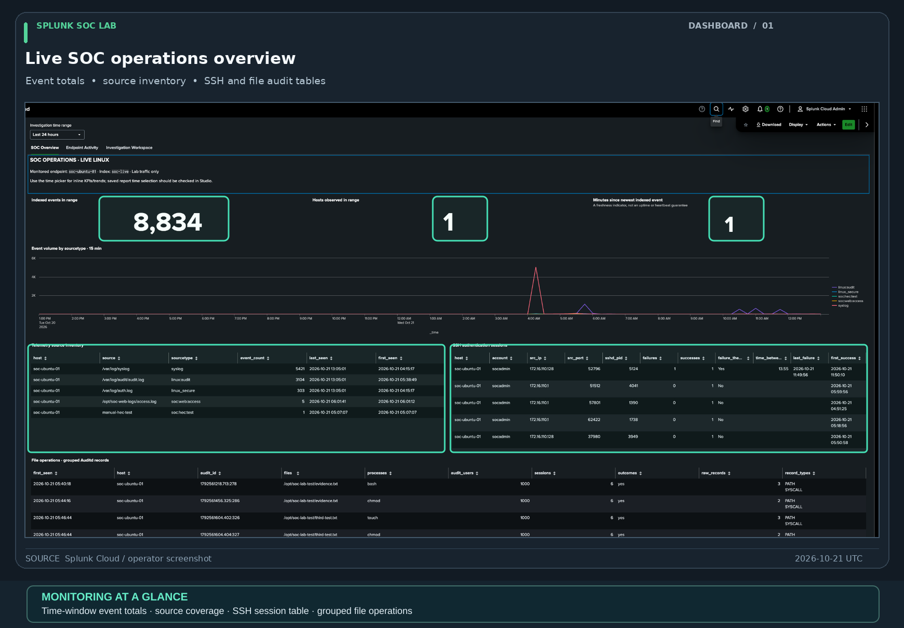

# Splunk SOC Lab — Security Monitoring & Investigation

I built this hands-on lab to practice what a security analyst does: **monitor a computer for activity, investigate what happened, and explain the findings using evidence.**

I connected two virtual Linux computers to Splunk Cloud, a platform used to search and investigate security records. One computer generates planned test activity; the other records it. I built a dashboard to examine those records and documented three investigations.

**These are controlled training exercises, not real attacks.** The Linux cases use actual logs collected from my lab. The earlier Windows/VPN case uses a clearly labeled practice dataset.

## Start here — a complete investigation

### SOC-003: What happened after a remote login?

**The question:** After someone signs in to a server, can I determine what they did next—and avoid mixing in unrelated activity?

I signed in to my Ubuntu test server from a separate Kali Linux computer, then investigated the records in Splunk.

1. **Find the login.** Identify when the server accepted the connection and where it came from.
2. **Follow the right activity.** Match the login with the server's records of commands and file changes, rather than assuming everything nearby is connected.
3. **Check the original evidence.** Confirm that a test file really was created, and avoid counting several log entries as separate actions.
4. **Write the conclusion.** Explain why this was expected, authorized lab activity—not evidence of a break-in.

*An actual Splunk screenshot from SOC-003, annotated to show the connection between a login and the related server activity. [View the original screenshot](investigations/SOC-003/screenshots/04-session54-correlation.png).*

**[Read the completed SOC-003 case study and view all nine evidence screenshots →](investigations/SOC-003/case-report.md)**

## Explore the project

| Where to go | What you'll find |
|---|---|
| **[SOC-003 — Featured investigation](investigations/SOC-003/case-report.md)** | A full case write-up: the question, evidence, timeline, findings, and annotated screenshots |
| **[Security monitoring dashboard](dashboards/README.md)** | Five annotated screenshots of the dashboard I built to review activity and investigate events |
| **[SOC-002 — Earlier Linux investigation](investigations/SOC-002/README.md)** | A second investigation following a remote login to commands and file creation |
| **[SOC-001 — Windows/VPN practice case](investigations/SOC-001/README.md)** | A separate investigation using 205 clearly labeled simulated security records |

Want to see the screenshots without reading every report? Visit the **[evidence gallery](evidence/README.md)**.

## What this project demonstrates

- **Security monitoring:** Set up log collection so activity from a Linux server could be searched in Splunk.
- **Investigation:** Worked backward from recorded events to understand what occurred and which events were actually related.
- **Threat detection:** Created reusable searches for login activity, commands, file changes, and web requests.
- **Dashboard building:** Built three views that help organize monitoring and investigations.
- **Case reporting:** Documented timelines, screenshots, conclusions, and important limits—without claiming that expected test activity was a real attack.

## How the lab works

Both computers run as virtual machines on my Mac. **Kali Linux** is my test computer. **Ubuntu Server** is the computer I monitor. Ubuntu records logins, commands, file activity, and web requests; a Splunk forwarding service sends those records to **Splunk Cloud**. I use saved searches and a dashboard to review them.

For implementation details, see the [lab architecture and setup](architecture/lab-setup.md) and [log collection documentation](telemetry/README.md).

## The dashboard

I built a three-view dashboard to make security records easier to understand and investigate:

| View | What it helps me do |
|---|---|
| **SOC Overview** | Check whether the main log sources are sending data and see a summary of recent activity |
| **Endpoint Activity** | Review commands, administrative activity, file changes, and web requests |
| **Investigation Workspace** | Focus on the activity connected to a particular login, alongside a wider timeline |

*Actual Splunk Cloud dashboard screenshot. Its totals describe the selected time range; they are not a guarantee that monitoring is always available. [Original screenshot](dashboards/screenshots/01-soc-operations-overview.png).*

**[Explore the dashboard and its five annotated screenshots →](dashboards/README.md)**

## Other investigations

### SOC-002 — Following a login to a file change

Using real logs from my Linux lab, I followed a remote login to the commands that were run and a file that was created. This case helped me practice linking the right events together rather than counting every log entry as a separate action.

**[Read SOC-002](investigations/SOC-002/README.md)**

### SOC-001 — Investigating suspicious-looking activity

Using **205 simulated security records**, I reviewed repeated failed logins, a successful login, account lookups, an unusual domain-name lookup, and a Windows account-group change. The sequence deserved closer review, but the available data did not prove that an account had been compromised.

**[Read SOC-001](investigations/SOC-001/README.md)**

## Searches and technical work

I created reusable Splunk searches to answer practical questions: Who signed in? Were there failed logins? Which commands ran? What files changed? What web requests were recorded? Which events belonged to the same login?

The project includes **eight saved live Linux reports** and **five historical reports** for the synthetic dataset. These are searches I can run again in Splunk; they are **not deployed real-time alerts**. Selected searches and case evidence have been tested; the [validation matrix](docs/linux-report-validation-matrix.md) distinguishes those results from additional checks.

For the technical detail, see the [Linux detection catalog](detections/linux/README.md), [historical detection catalog](detections/README.md), [SPL/report runbook](docs/report-save-runbook.md), [test plan](docs/detection-test-plan.md) and [analyst triage playbook](docs/detection-triage-playbook.md).

## Tools and technologies

| Tool | Role |
|---|---|
| Splunk Cloud / SPL | Central log search, reporting, dashboard and investigation |
| Splunk Universal Forwarder 10.4.3 | Forward Linux logs to Splunk Cloud |
| Ubuntu Server 24.04 | Monitored Linux endpoint |
| Kali Linux | Authorized activity-generation workstation |
| Linux Auditd | Record selected process executions and monitored file operations |
| VMware Fusion / Apple Silicon | Run the isolated lab virtual machines |

The live data is stored in Splunk's `soc-live` index; the synthetic historical data is kept in `soc_lab`.

## Technical documentation — for a deeper look

- [SOC-003 case report and screenshot gallery](investigations/SOC-003/case-report.md)
- [Dashboard screenshots and exported JSON](dashboards/README.md)
- [Evidence index](evidence/README.md)
- [Lab architecture and setup](architecture/lab-setup.md)
- [Telemetry and log collection](telemetry/README.md)
- [Detection engineering catalog](detections/README.md)
- [Linux report validation matrix](docs/linux-report-validation-matrix.md)
- [SOC investigation triage playbook](docs/detection-triage-playbook.md)
- [Lessons learned](docs/lessons-learned.md)
- [Demonstration storyboard](docs/recruiter-demo-script.md)
- [Project roadmap](docs/roadmap.md)

## Scope and lessons learned

This is a **personal, controlled security lab**, not a production SOC. The investigations document observed evidence and do not represent real-world compromises. A successful login alone is not proof of unauthorized access, and a suspicious-looking command does not establish malicious intent.

The dashboard and case reports are documented, with authentic screenshots. Additional work remains around full saved-search reconciliation, scheduled alerting, Auditd rule persistence and collection hardening; those operational improvements are tracked separately in the [roadmap](docs/roadmap.md) and [limitations](docs/limitations.md).
