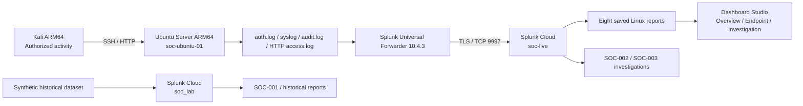

# Lab architecture and setup

## Verified environment
- Apple Silicon Mac, 24 GB RAM, VMware Fusion.
- Ubuntu Server 24.04.5 LTS ARM64, hostname `soc-ubuntu-01`, monitored endpoint.
- Kali Linux Rolling, controlled lab activity generator; SSH and ICMP connectivity to Ubuntu verified.
- VMware NAT subnet 172.16.110.0/24; lab Ubuntu 172.16.110.130 and Kali 172.16.110.128 (historical local addresses; may change).
- Splunk Cloud uses distinct indexes `soc_lab` (historical synthetic) and `soc-live` (real Linux events).

## Data flow
Kali → Ubuntu authentication/HTTP activity → Linux log files → ARM64 Splunk Universal Forwarder 10.4.3 → TLS forwarding TCP 9997 → Splunk Cloud → SPL investigation.

## Observations and pending checks
- Forwarder reported active SSL connection to Splunk Cloud, with no inactive configured forwards.
- Ubuntu root filesystem showed ~9.8 GB despite intended ~40 GB disk; inspect actual disk/LVM layout before changing it.
- Verify network restrictions, time sync, TLS peer verification, restart behavior and log rotation.
- NAT is not a complete isolation boundary.

## Architecture diagram

The diagram documents the intended lab data flow, not independently audited TLS peer validation. The HTTP server was temporary. Lab IP addresses are historical and may change.

For real screenshots, see the [dashboard gallery](../dashboards/README.md#screenshot-gallery) and [SOC-003 exhibits](../investigations/SOC-003/case-report.md#evidence-gallery--real-screenshots). VMware configuration screenshots have not been published.
