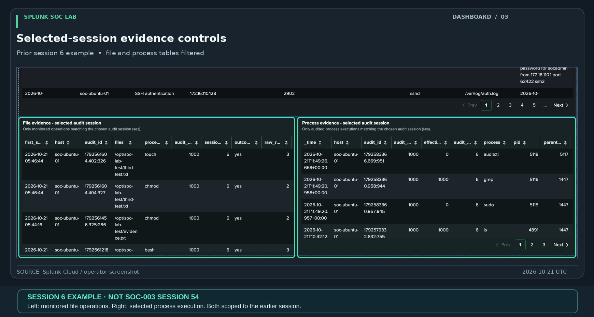
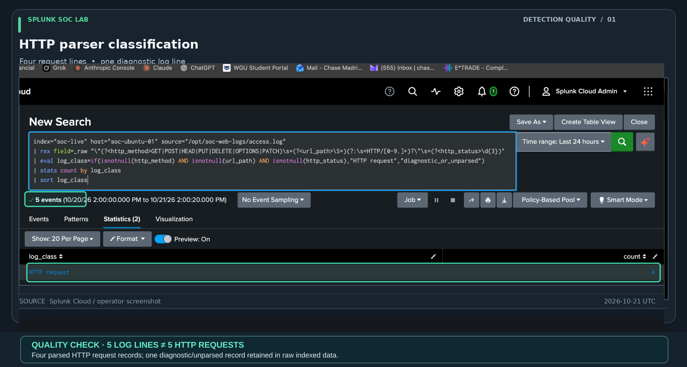
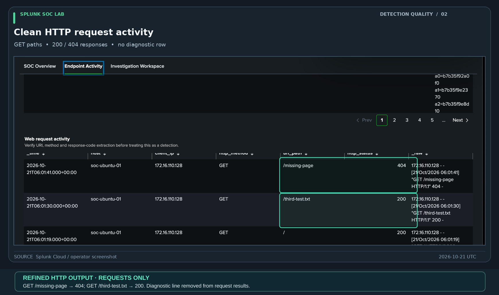

# Splunk Dashboard Studio — Security Monitoring & Investigation

I built a three-tab Splunk Dashboard Studio workspace to monitor Linux security logs and support incident investigations. The dashboard brings authentication events, process activity, monitored file changes, and HTTP requests into a single place, with time and session filters for focused analysis.

## Dashboard views

| View | Purpose |
|---|---|
| **SOC Overview** | Review log ingestion, monitored sources, event volume, and authentication patterns |
| **Endpoint Activity** | Examine administrative activity, process execution, file changes, and web requests |
| **Investigation Workspace** | Correlate an SSH login with its associated activity while retaining a broader event timeline for context |

The dashboard was used during **[SOC-003](../investigations/SOC-003/case-report.md)** to trace an authorized SSH session and document the commands and file activity associated with it.

**[View five annotated dashboard screenshots](#screenshot-gallery)** · **[Explore the exported dashboard configuration](soc-lab-dashboard-studio.json)**

The sections below cover the investigation workflow, implementation, and validation details.

## Investigation workflow

1. Select a time window containing the known activity.
2. Identify the relevant SSH connection and its source IP and process ID.
3. Confirm the matching Auditd LOGIN record before using the Audit session filter.
4. Enter the assigned session number to inspect case-specific process and file evidence.
5. Review the broader timeline separately; events in that timeline are not necessarily attributable to the selected login.
6. Inspect raw Auditd record groups when an individual file operation requires confirmation.

**Important:** Session numbers are not globally unique; use host, timestamp and matching LOGIN evidence for attribution. Dashboard counts reflect the underlying SPL aggregation and do not necessarily count human-entered commands.

## Configuration and validation

- [Working Dashboard Studio JSON](soc-lab-dashboard-studio.json) — exported from Splunk Cloud on October 21, 2026.
- [Setup and troubleshooting](dashboard-studio-setup.md) — layout and data-source configuration.
- [Validation record](../docs/dashboard-validation-2026-10-21.md) — time picker, saved-report references, HTTP parsing and session-filter tests.
- [Saved report runbook](../docs/report-save-runbook.md) — eight exact report titles and canonical SPL references.
- [SOC-003 case report](../investigations/SOC-003/case-report.md) — complete session 54 investigation with evidence.

The eight saved-report sources use the global time input rather than their individually saved search windows. The HTTP request panel excludes a diagnostic line that is retained in the raw index. Additional report-by-report tests and exact saved-SPL reconciliation are still outstanding.

The [diagnostic dashboard JSON](diagnostic-dashboard-studio.json) is retained as troubleshooting history and is **not** the working dashboard export.

## Screenshot gallery

These are annotated presentation copies of curated captures from the real Splunk environment. Editorial outlines guide the reader without changing the captured log values. Each exhibit links to its PNG presentation source. Exhibit 04's PNG was additionally cropped to exclude unrelated personal browser tabs; the Splunk search and result data were preserved.

### 01 — SOC Overview

*The SOC Overview presents indexed-event volume, monitored sources, SSH sessions, and grouped file operations for the selected time range. Counts are time-window snapshots, not an uptime guarantee.* · [Original PNG](screenshots/01-soc-operations-overview.png)

### 02 — Endpoint Activity

*Endpoint Activity combines sudo, audited process execution, and HTTP tables. This earlier capture includes a diagnostic line classified as unparsed; the cleaned HTTP evidence appears in Exhibit 05.* · [Original PNG](screenshots/02-endpoint-telemetry.png)

### 03 — Investigation Workspace

*Earlier audit session `6` demonstrates session-filtered file and process tables. This is a separate dashboard example, not SOC-003's session `54`.* · [Original PNG](screenshots/03-session-scoped-evidence.png)

### 04 — HTTP classification test

*Parser validation distinguished four HTTP request records from one diagnostic/unparsed record among five indexed log lines. The browser-tab strip was cropped from the public PNG and annotated exhibit without changing the Splunk results.* · [Cropped PNG](screenshots/04-http-request-classification.png)

### 05 — Corrected HTTP request view

*The refined HTTP request table shows parsed methods, paths, and response codes (including `404` and `200`) without treating the diagnostic line as an HTTP request.* · [Original PNG](screenshots/05-clean-http-request-view.png)

## Remaining operational checks

Exact saved-report SPL comparison, complete time-range behavior tests, Auditd rule persistence, forwarder restart/log rotation, and alert scheduling remain separate tasks. See the [project roadmap](../docs/roadmap.md).
