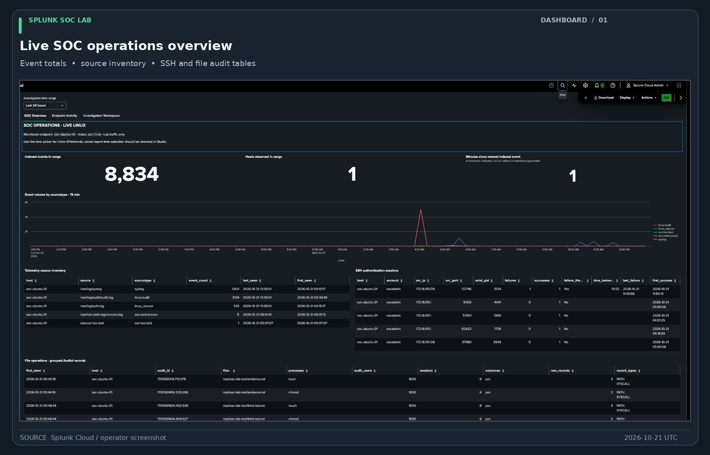
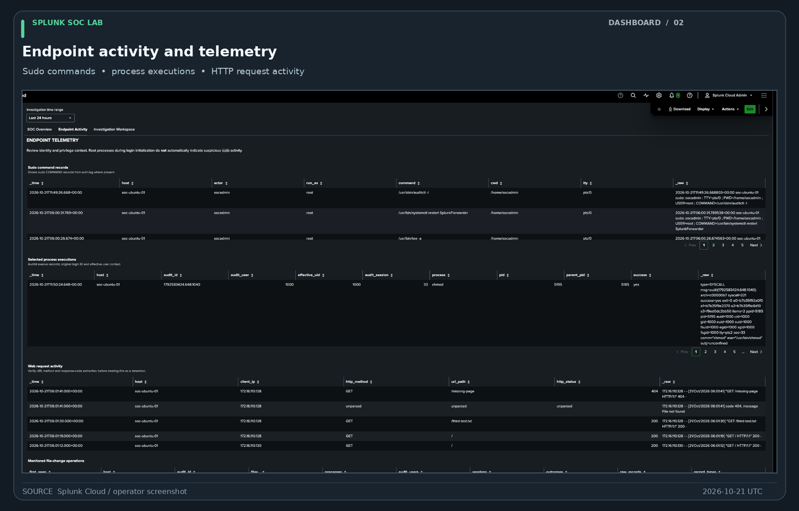
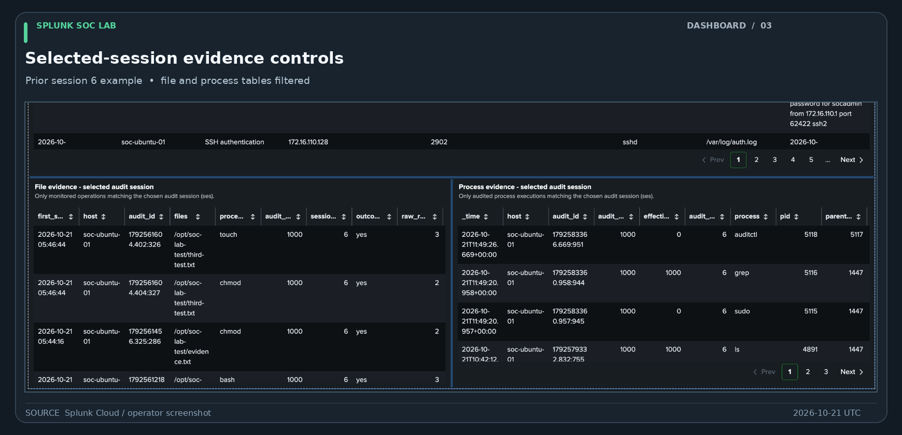
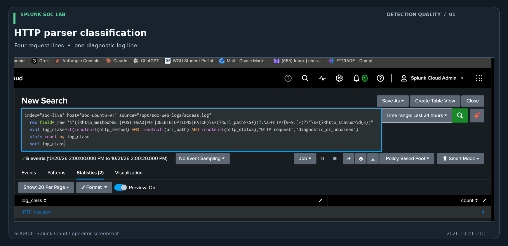
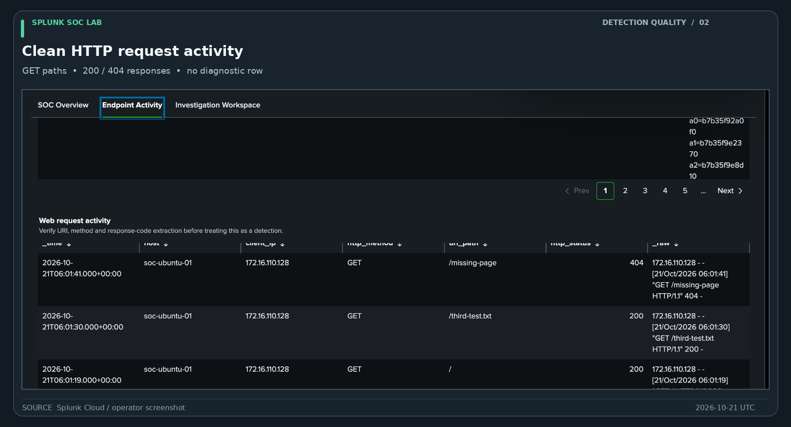

# Roadmap

- [x] Import 205 synthetic SOC events and investigate SOC-001.
- [x] Save four historical detection reports and one correlation report.
- [x] Install Ubuntu/Kali lab VMs and verify connectivity.
- [x] Connect ARM64 Universal Forwarder to Splunk Cloud.
- [x] Validate syslog, auth, Auditd and HTTP telemetry.
- [ ] Step 42: cleaner investigation timeline.
- [x] Step 43: SSH session attribution with Auditd (Kali SSH PID 4937 mapped to audit session 27).
- [x] Step 44: group related Auditd records by audit event ID.
- [x] Complete SOC-002 investigation and evidence-backed report (authorized lab activity).
- [ ] Build and validate Linux-specific detections (LINUX-DET-003 manual positive/negative tests passed for monitored lab file changes; saved Splunk Report operator-confirmed; broader tuning and scheduled-alert evaluation still pending).
- [x] Validate the three-tab dashboard renders, references eight Linux reports, binds global time inputs, displays parsed HTTP request rows, and filters candidate case evidence by Audit session 33 versus 6.
- [ ] Independently verify SSH-to-Auditd attribution, audit count semantics, all report time-range behaviors, and source-of-truth saved SPL.
- [ ] Export exact saved SPL searches.
- [x] Publish curated, genuine dashboard screenshots (unrelated browser clutter cropped; data preserved).
- [ ] Verify Auditd rule persistence and forwarder/log rotation behavior.
- [ ] Investigate Ubuntu disk capacity and tune event volume.
- [ ] Rotate/revoke temporary HEC token and secure credential copies.
- [ ] Record short portfolio demonstration video.

See [detection-to-dashboard implementation plan](detection-to-dashboard-plan.md) for the exact order, test gates, report names and dashboard panels.

- [x] Save eight live Linux reports in Splunk Cloud (operator-confirmed 2026-10-21; individual results, app contexts and permissions still require validation).
- [x] Complete SOC-003 controlled Kali-to-Ubuntu case study and publish the evidence-backed report.

The latest [production JSON export](soc-lab-dashboard-studio.json) was copied from the operator's working Splunk Cloud Dashboard Studio source on 2026-10-21, including the session-filtered Investigation Workspace. It preserves all three edge-aligned Grid tabs and binds each of the eight saved report sources to the global time picker. See [source setup/troubleshooting](dashboard-studio-setup.md) and [validation findings](../docs/dashboard-validation-2026-10-21.md). The [temporary diagnostic JSON](diagnostic-dashboard-studio.json) is retained for reproducible troubleshooting.

## Latest validation checkpoint

The dashboard export now includes a session-specific input and case-filtered SSH correlation, process and file evidence tables. The operator's session 33/6 comparison and HTTP classification (4 request records, 1 diagnostic) were documented on 2026-10-21. Remaining questions concern independent PID/session attribution, precise saved HTTP report SPL, and broader operational testing. See [validation findings](../docs/dashboard-validation-2026-10-21.md).

- [x] Sync actual working Dashboard Studio JSON export (all eight named saved reports and global time bindings) to GitHub.

## Screenshot gallery

These are curated screenshots captured from Splunk Cloud. Titles, frames, and explanatory captions have been added **outside** the screenshots; the Splunk rows, fields, timestamps and metrics themselves have not been recreated.

### SOC Operations

### Endpoint Activity

### Session-scoped investigation evidence

### HTTP parser validation

The HTTP dataset includes **four parsed request lines** and **one distinct server diagnostic line**. The corrected request panel displays GET requests and response codes without counting the diagnostic message as a request.

For the actual SSH-to-Auditd investigation, see the [SOC-003 case report](../investigations/SOC-003/case-report.md).
