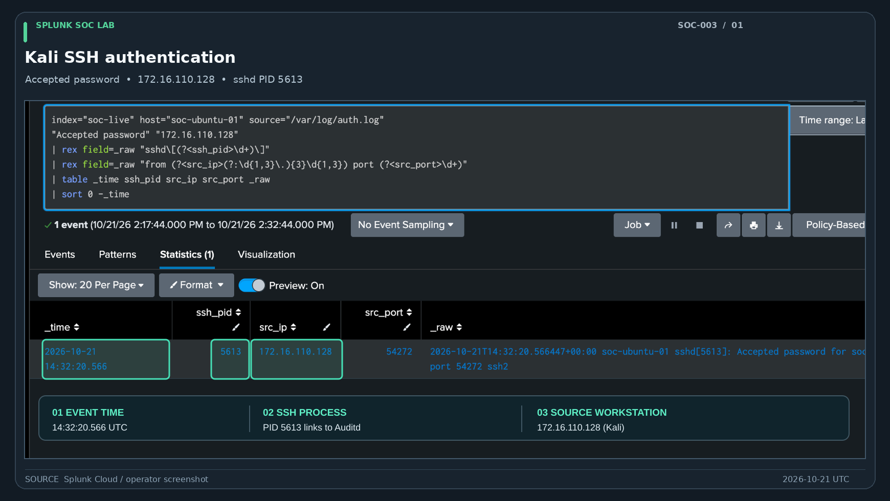
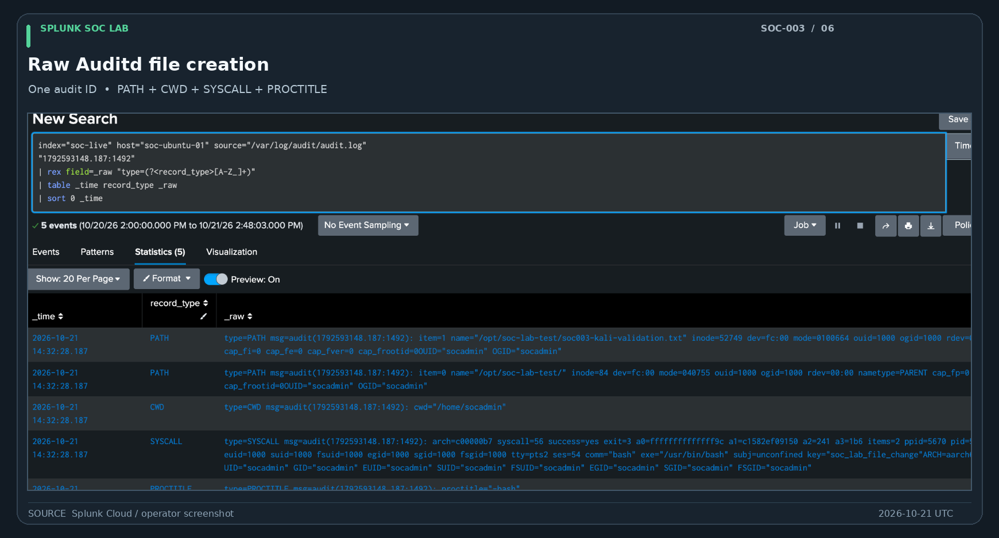

# Evidence gallery — Splunk SOC Lab

This page highlights **real screenshots from the live Linux monitoring lab**. Start with the SOC-003 investigation if you want to see how authentication, process activity and a file operation were connected into one evidence-supported case.

## Featured evidence

### SOC-003 — Trace an SSH login to endpoint activity

*The SSH authentication record identifies Kali (`172.16.110.128`) as the source, shows the accepted login, and provides PID `5613` for correlation with Auditd. [Original, unannotated screenshot](../investigations/SOC-003/screenshots/01-kali-ssh-authentication.png).*

*Matching SSH and Auditd LOGIN evidence links the connection to audit session 54.*

*Five related Auditd records describe one successful file-creation event.*

**[Read the complete SOC-003 case report and all nine screenshots](../investigations/SOC-003/case-report.md#evidence-gallery--real-screenshots)**

### Splunk Dashboard Studio — Monitoring and investigation

*Live source inventory, SSH sessions and grouped file operations.*

*Saved-report views for endpoint behavior.*

*The corrected request table separates HTTP requests from a server diagnostic record.*

**[See the full five-image dashboard gallery](../dashboards/README.md#screenshot-gallery)**

## Other documented investigations

- [SOC-002 — Live Linux endpoint investigation](../investigations/SOC-002/README.md): completed SSH-to-Auditd investigation; dedicated screenshots have not been published.
- [SOC-001 — Synthetic multi-source investigation](../investigations/SOC-001/README.md): completed case analysis; dedicated timeline and correlation screenshots have not been published.

## Evidence collection and review backlog

These items are documentation or validation follow-ups, **not missing portions of the completed SOC-003 case**.

- [ ] Publish a suitably redacted forwarder/destination configuration screenshot.
- [ ] Publish dedicated SOC-002 screenshots if they add value beyond SOC-003.
- [ ] Publish SOC-001 timeline, correlation and historical report screenshots if available.
- [ ] Publish the LINUX-DET-003 exploratory file-event grouping screenshot (25 raw records / 7 audit operations).
- [ ] Record remaining Linux detection positive/negative tests and saved-SPL reconciliation.
- [ ] Visually inspect each published screenshot for legibility and unintended sensitive information.

## Evidence integrity

The published images are described as captures from the actual Splunk environment. Editorial cropping, framing and captions are acceptable; data values and Splunk interface contents should not be fabricated or altered. The screenshots are not independent forensic acquisitions. The earlier Ubuntu-originated session 53 is not attributed to the Kali-originated session 54.

Record the query, time range, UTC/local-time basis and evidence limitations when adding exhibits. Never publish credentials, tokens, sensitive logs or private deployment packages.
